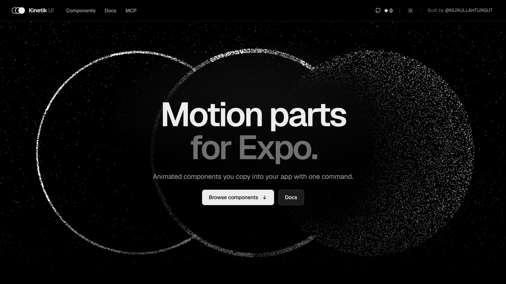

<p align="center">
  <a href="https://kinetik-ui.dev">
    <picture>
      <source media="(prefers-color-scheme: dark)" srcset=".github/assets/hero-light.jpg" />
      
    </picture>
  </a>
</p>

<h1 align="center">Kinetik UI</h1>

<p align="center">
  <strong>Motion parts for Expo.</strong><br />
  136 animated components and 5 screen templates for React Native, copied into your app as source.
</p>

<p align="center">
  <a href="https://www.npmjs.com/package/kinetik-ui"></a>
  
  
  
  
  
  
  
  <a href="LICENSE"></a>
</p>

<p align="center">
  <a href="https://kinetik-ui.dev"><strong>kinetik-ui.dev</strong></a> ·
  <a href="https://kinetik-ui.dev/components">Components</a> ·
  <a href="https://kinetik-ui.dev/docs/getting-started">Documentation</a> ·
  <a href="https://kinetik-ui.dev/registry">Registry</a> ·
  <a href="https://www.npmjs.com/package/kinetik-ui">npm</a>
</p>

---

> **Requires the React Native New Architecture** (Reanimated 4). The legacy architecture is not supported.

Motion and effect components for Expo and React Native, built on Reanimated, Gesture Handler and Skia. Components are copied into your project as TypeScript source (the shadcn model), so you own the code and can change anything.

```bash
npx kinetik-ui init
npx kinetik-ui add glint-card
```

`add` copies the component and the shared tokens it needs, then installs native dependencies with `npx expo install`, so their versions always match your Expo SDK.

## What you get

- **136 components and 5 screen templates**, each with a live demo, a props table and notes on when _not_ to use it.
- **Runs on the UI thread.** Gestures, springs and shaders are worklets; a busy JavaScript thread does not drop frames.
- **Accessible by default.** Every component has a reduced-motion version, screen-reader labels and roles, and 44 pt touch targets. See the [checklist](docs/accessibility.md).
- **One design language.** Colours, spacing, type, shadows and three springs come from shared tokens; nothing hard-codes a colour. Brand it with `<KinetikProvider colors={{ ember: '#7C5CFF' }}>`.
- **Agent-ready.** An MCP server (`npx kinetik-ui mcp`), `/llms.txt`, a markdown version of every docs page and an `AGENTS.md` section for your project (`npx kinetik-ui agents`).

## Components

| Category    | Component         | What it does                                                                        |
| ----------- | ----------------- | ----------------------------------------------------------------------------------- |
| Background  | Aurora Veil       | A slow, flowing aurora drawn by a fragment shader, for screen and hero backgrounds. |
|             | Grain Drift       | A drifting four-colour mesh gradient under moving film grain.                       |
|             | Ripple Field      | A dot grid that ripples outward from every touch.                                   |
| Card        | Aperture Card     | A card closed by a camera-like iris whose blades turn open to reveal the content.   |
|             | Compare Slider    | Two versions of a picture with a divider you drag across.                           |
|             | Deckfall          | A stack of cards swiped away one at a time, the cards behind rising into place.     |
|             | Drift Marquee     | An endless row that drifts on its own, can be flung, and leans into the speed.      |
|             | Expand Card       | A row that opens into a card, its thumbnail growing into a wide picture.            |
|             | Fan Stack         | A loose pile of pictures that fans out like a hand of cards.                        |
|             | Flip Ledger       | A two-sided card that turns over in 3D, sized to the taller face.                   |
|             | Fold Panel        | A panel that unfolds in place, its body springing to its height.                    |
|             | Glint Card        | A card with a specular glint that follows the finger or the tilt of the phone.      |
|             | Parallax Carousel | A paging carousel whose pictures drift inside their cards.                          |
|             | Scroll Stack      | Cards that pin to the top and pile up as you scroll.                                |
|             | Story Card        | Full-bleed stories with progress bars: tap to step, hold to pause.                  |
|             | Tilt Deck         | A card that tilts in 3D under the finger, with parallax layers.                     |
|             | Question Deck     | A questionnaire card on a shuffling stack with sliding questions.                   |
|             | Wallet Stack      | Glint Cards in a stitched pocket that fan out with a counting balance.              |
|             | Streak Card       | A day count that pops in amid confetti over a row of week marks.                    |
|             | Boarding Pass     | A notched paper ticket; scan the barcode and the stub tears off.                    |
|             | Book Pocket       | Book covers in a frosted acrylic pocket that rise and fan when pressed.             |
|             | Now Playing       | A dark music widget: the cover springs forward on play and the icon morphs.         |
|             | Vinyl Player      | A record half out of its sleeve that spins while the track plays.                   |
| Interaction | Beam Button       | A button with a beam of light running around its edge.                              |
|             | Bloom Menu        | A floating button whose actions spring out one after another.                       |
|             | Copy Chip         | A copy button whose two pages fold into a check.                                    |
|             | Elastic Slider    | A slider that stretches like rubber past its ends and springs back.                 |
|             | Expand Toolbar    | Icon buttons where the picked one grows to show its name.                           |
|             | Hold to Confirm   | Press and hold: a ring fills and turns into a check mark.                           |
|             | Like Burst        | A heart that pops with a ring and sparks while the count rolls.                     |
|             | Liquid Tabs       | A tab bar whose indicator flows like liquid between tabs.                           |
|             | Magnet Button     | A button that leans toward the finger before it is touched.                         |
|             | Morph Icon        | An icon whose glyph reshapes: menu to close, play to pause.                         |
|             | Press Jelly       | A primary button that squashes like jelly and wobbles back.                         |
|             | Pulse Toggle      | A switch whose thumb stretches mid-flight and pulses when it turns on.              |
|             | Slide to Confirm  | Drag the knob across to confirm; it lands as a check.                               |
|             | Split Button      | A primary action with alternatives behind a chevron.                                |
|             | Status Button     | Folds into a spinner while it works, then opens with a check or shakes.             |
|             | Swipe Row         | A list row with actions behind it; a long swipe runs the edge one.                  |
|             | Theme Switch      | A sun whose rays turn and draw in as a shadow leaves a moon.                        |
|             | Two-Step Button   | Splits into Cancel and Confirm before a destructive action.                         |
|             | Peek Folder       | Tiles glowing through a glass folder pocket, springing up on tap.                   |
| Inputs      | Choice Cards      | Option cards with one selection ring that glides between them.                      |
|             | Code Field        | A one-time-code field: digits pop in, wrong codes shake.                            |
|             | Filter Chips      | Chips that grow a check and turn to a tint when picked.                             |
|             | Float Field       | A text field whose label rises to the edge, with a ring and a shake for errors.     |
|             | Glide Radio       | A radio group whose one dot travels between the rings like ink.                     |
|             | Grow Area         | A multi-line field that grows a line at a time, with a limit ring.                  |
|             | Ink Check         | A checkbox whose tick is inked in one stroke.                                       |
|             | Inline Edit       | Text you rename in place, confirmed with a check.                                   |
|             | Money Field       | A currency field typed like a till, every place rolling.                            |
|             | Month Calendar    | A month to pick a date or a range; a disc glides between days.                      |
|             | Morph Select      | A select whose field stretches open into its list.                                  |
|             | Password Meter    | A new-password field with a meter and rules that tick off.                          |
|             | Plan Toggle       | A billing-period toggle with a popping badge and rolling price.                     |
|             | Range Slider      | A two-ended slider over an optional histogram.                                      |
|             | Reveal Field      | A password field with an eye that blinks.                                           |
|             | Roll Stepper      | A number stepper whose figure rolls and speeds up while held.                       |
|             | Search Morph      | A search button that stretches into a search field.                                 |
|             | Signature Pad     | Finger signing with ink that thins with speed.                                      |
|             | Star Rating       | Stars you tap or drag across, swelling as they fill.                                |
|             | Swatch Picker     | Colour swatches with a ring that glides to the pick.                                |
|             | Tag Field         | Typed words that pop into removable tags.                                           |
|             | Time Wheel        | Drum-like wheels for a time of day that snap row by row.                            |
|             | Gradient Slider   | Hue or white-balance gradient with a ring knob, live swatch and action.             |
|             | Rotation Ruler    | A straighten dial of degree ticks that glides and snaps to level.                   |
|             | Step Slider       | A few dotted stops with a snapping knob and a spinning action.                      |
|             | Palette Strip     | Joined colour swatches that wipe to new colours in turn.                            |
|             | Segment Bar       | A segmented control whose pill glides to the pick, with an action.                  |
|             | Aspect Picker     | Aspect-ratio frames drawn to scale with a sliding highlight.                        |
|             | Seat Picker       | Armchairs that fill as you add seats, a rolling stepper and seats left.             |
|             | Plan Picker       | Plan cards in a tray whose pick lifts, over a button with streaming chevrons.       |
|             | Intensity Slider  | A soft gradient slider with a Low-to-High ruler that lights to the value.           |
|             | Topic Picker      | Topic chips drifting in opposite rows; picks pop in a soft colour.                  |
| Disclosure  | Fade Scroll       | A scroll view whose edges fade only where there is more.                            |
|             | Lift Menu         | Hold to lift the content above a dimmed screen with its actions.                    |
|             | Pop Menu          | A menu that unfolds from its trigger, rows sliding in.                              |
|             | Read More         | Long text folded to a few lines that fade, let out on a spring.                     |
|             | Split Pane        | Two panes with a handle that springs to resting points.                             |
|             | Tip Bubble        | A short tip that grows out of its anchor and closes by itself.                      |
|             | Tree View         | Nested folders whose branches grow open.                                            |
| Overlays    | Action Sheet      | Actions from the bottom edge that follow a drag down.                               |
|             | Pop Dialog        | A dialog that rises and settles over a dimmed screen.                               |
|             | Side Drawer       | A drawer from the side whose rows slide in one by one.                              |
| Text        | Letter Morph      | A label that morphs letter by letter: Save to Saved.                                |
|             | Marker Highlight  | Key phrases marked as if with a highlighter, one after another.                     |
|             | Odometer          | Digits that roll like a mechanical counter.                                         |
|             | Scramble Text     | Characters cycle through glyphs and lock in from left to right.                     |
|             | Shine Text        | A band of light sweeping across a line of text.                                     |
|             | Slot Text         | Characters that spin like slot reels onto the new text.                             |
|             | Typewriter        | Text typed out with a human rhythm, phrase after phrase.                            |
|             | Word Cascade      | A paragraph that arrives word by word.                                              |
|             | Word Rotator      | One word in a line that rolls to the next, letter by letter.                        |
| Navigation  | Dock Bar          | A floating bottom bar whose items swell under the finger.                           |
|             | Morph Sheet       | A bottom sheet with snap points that blurs the screen behind it.                    |
|             | Page Dots         | Page dots that follow the scroll as a worm or a pill.                               |
|             | Pager             | Pagination with a gliding pill and rolling page numbers.                            |
|             | Parallax Header   | A header that scrolls at half speed and hands off to a compact bar.                 |
|             | Scroll Tabs       | Tabs over swipeable pages, the underline tied to the swipe.                         |
| Feedback    | Confetti Burst    | Confetti drawn in a single Skia draw call, physics on the UI thread.                |
|             | Count Badge       | A corner count that springs in, jumps as it rises and rolls.                        |
|             | Countdown         | Digits that drop in as they change, then a Live pill.                               |
|             | Dot Loader        | Dots that hop, breathe or sit in a typing bubble.                                   |
|             | Empty State       | Three cards fan out above the next step on an empty screen.                         |
|             | Notice Bar        | An announcement bar whose messages take turns rolling in.                           |
|             | Progress Bar      | A bar that springs to each amount, with a sheen and a green finish.                 |
|             | Ring Spinner      | An arc that stretches as it turns and closes into a check.                          |
|             | Skeleton Sweep    | Loading placeholders with one light band across the whole layout.                   |
|             | Step Tracker      | Progress through steps: the line fills and steps take a check.                      |
|             | Toast Stack       | Notifications that stack like cards, fan out and swipe away.                        |
|             | Scan Progress     | A scan band lights pixel squares over an image while a ring fills.                  |
| Data        | Activity Rings    | Concentric progress rings that wind up; past the goal they lap.                     |
|             | Avatar Stack      | Overlapping faces that fan out with their names.                                    |
|             | Bar Chart         | Bars that spring up in a wave and light up under the finger.                        |
|             | Brush Chart       | A long series with a window you drag and resize to zoom.                            |
|             | Chat Thread       | Grouped chat bubbles that rise in, with typing dots.                                |
|             | Donut Chart       | A ring of rounded slices that sweeps in; tap one to bring it forward.               |
|             | Gauge Meter       | A dial that swings to its value while the figure counts up.                         |
|             | Heat Grid         | Days shaded by activity, popping in as a wave; drag to read.                        |
|             | Line Chart        | A smooth line that draws itself in, with a scrubbing guide and label.               |
|             | Radar Chart       | Shapes that grow from the centre and morph to new values.                           |
|             | Ridgeline         | Overlapping distributions; tap one to lift it and mark its quartiles.               |
|             | Slope Chart       | Before and after on two axes, rises in blue.                                        |
|             | Sort Table        | A table whose rows spring to their new places when sorted.                          |
|             | Stat Card         | A figure that counts up, with a change pill and a sparkline.                        |
|             | Stream Graph      | Layered streams that morph between datasets.                                        |
|             | Timeline          | Events along a rail that pop in and draw down in turn.                              |
|             | Treemap           | Nested, near-square tiles; tap a group to zoom into it.                             |
|             | Usage Meter       | What fills an allowance, segment by segment.                                        |
|             | Waffle Chart      | A ten-by-ten grid where each cell is one percent.                                   |
|             | Flight Track      | A flight card whose route fills behind a plane with blinking lights.                |
|             | Expense Card      | Category bars on a dashed grid that grow in, with a period menu.                    |
|             | Credit Score      | A score that counts up over a bar meter warming from red to green.                  |
|             | Vital Arcs        | Arcs that sweep from the corner around a score disc, values at their tips.          |
|             | Score Matrix      | A score that counts up as a dot grid lights, beside metric rows.                    |
|             | Agenda Card       | The date lit by a blue glow beside the next events sliding in.                      |
| Screens     | Onboarding        | A paged welcome with animated illustration panels and word-by-word titles.          |
|             | Paywall           | A feature carousel that advances on its own and swipeable plan cards.               |
|             | Login             | Email and password sign-in with inline errors and provider buttons.                 |
|             | Auth              | Passwordless sign-in: an email, a one-time code and a check once you are in.        |
|             | Profile           | An avatar in a turning ring, stats that count up and grouped settings rows.         |

Screen templates install into `components/kinetik/screens/` and bring the components they use.

## Requirements

- Expo SDK 54 or newer with the New Architecture on (the default since SDK 53). Developed and tested on SDK 57.
- A [development build](https://docs.expo.dev/develop/development-builds/introduction/). Skia and sensors need native code.
- Wrap your app in `<GestureHandlerRootView style={{ flex: 1 }}>` for gesture-driven components.

## CLI

| Command                  | What it does                                                                 |
| ------------------------ | ---------------------------------------------------------------------------- |
| `init`                   | Writes `kinetik.json`, copies tokens and motion presets, installs Reanimated |
| `add <name...>`          | Copies components (and their dependencies) and runs `expo install`           |
| `list`, `search <query>` | Browse the registry (`--json` for scripts)                                   |
| `diff [name...]`         | Show how your copies differ from the registry                                |
| `doctor`                 | Check the SDK, New Architecture, Babel config, dependencies and files        |
| `agents [--skill]`       | Add Kinetik guidance for AI agents to `AGENTS.md` (and an Agent Skill)       |
| `mcp`                    | Serve the registry to AI agents over the Model Context Protocol              |

The registry is also shadcn-compatible: `npx shadcn@latest add <registry>/r/glint-card.json` copies the files, but installs dependencies with npm rather than `expo install`, so prefer the Kinetik CLI.

## Repository

| Path                | What                                                                                                  |
| ------------------- | ----------------------------------------------------------------------------------------------------- |
| `packages/registry` | Source of truth: components, screen templates, tests, demos, docs, tokens, motion presets, hooks      |
| `packages/cli`      | The `kinetik-ui` CLI                                                                                  |
| `packages/mcp`      | MCP server used by `kinetik-ui mcp`                                                                   |
| `apps/playground`   | Expo app running every component and screen on a device                                               |
| `apps/docs`         | Docs site (Next.js + react-native-web): live previews, `/llms.txt`, markdown endpoints, `/r` registry |
| `scripts/`          | Registry and docs builds, perf and accessibility audits                                               |
| `tests/`            | Registry integrity tests                                                                              |

```bash
pnpm install
pnpm build:registry   # regenerate the published registry files
pnpm verify           # registry freshness, format, lint, typecheck, tests, integrity
```

Contributing: [CONTRIBUTING.md](CONTRIBUTING.md).

## License

[MIT](LICENSE). Dependencies keep their own licenses: [THIRD_PARTY_NOTICES.md](THIRD_PARTY_NOTICES.md).
